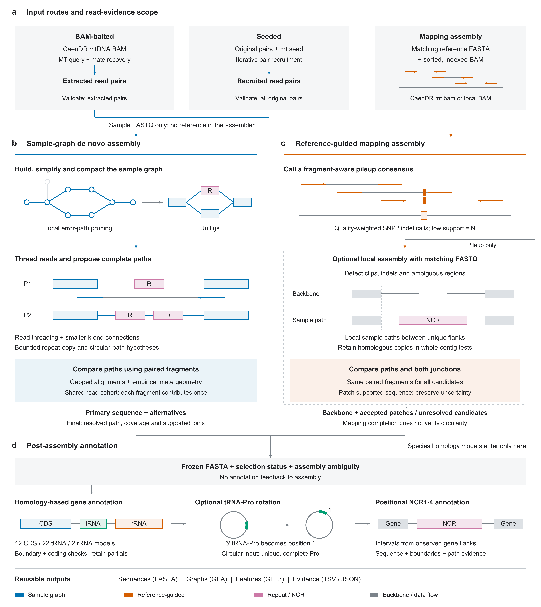

# Detailed method schematic: current native Rust workflow

This figure describes the current standalone `mitovarr` workflow. All panels
are schematic. The main README uses the separate five-panel
[overview Figure 1](../figures/README.md); this four-panel schematic provides
additional method detail.



- [Editable vector PDF](figure_1_workflow.pdf): preferred manuscript artwork.
- [Editable SVG](figure_1_workflow.svg): four named panel layers with live text.
- [600-dpi PNG](figure_1_workflow.png): preview and slide use.
- [English manuscript legend and Chinese explanation](figure_1_legend.md).
- [Reproducible drawing source](draw_figure_1.py).

## Layout and export

The artwork is **183 x 205 mm**, in RGB, with Arial body text at 5.7-7 pt and
bold lowercase panel labels at 8 pt. PDF fonts are embedded TrueType; SVG text
remains editable. The PNG is a rendering of the vector artwork, not the
submission master. The design follows the
[Nature artwork specifications](https://research-figure-guide.nature.com/figures/preparing-figures-our-specifications/)
and [double-column artwork dimensions](https://www.nature.com/documents/nature-final-artwork.pdf).
The English legend is below 250 words. Final journal layout may be adjusted by
the publisher; this figure does not imply acceptance or a validated performance
claim.

Rebuild with Python, ReportLab and Poppler available:

```bash
python docs/figure_1_workflow/draw_figure_1.py --png --dpi 600
```

For PDF and SVG alone, omit `--png`. On systems without the macOS Arial font
directory, set `MITOVARR_FIGURE_FONT_DIR` to a directory containing `Arial.ttf`
and `Arial Bold.ttf`. These are documentation-only dependencies; the Rust
build and runtime do not call this script or any external bioinformatics tool.

## What each panel represents

| Panel | Current implementation | Method and interpretation |
| --- | --- | --- |
| a | [`caendr.rs`](../../src/caendr.rs), [`bait.rs`](../../src/bait.rs), [`cli.rs`](../../src/cli.rs) | [CaenDR extraction](../caendr.md) and [input contracts](../../README.md#workflows-and-input-scope). BAM-baited input and validation have `mt-bam-extracted` scope. Seeded recruitment must converge before a final assembly can be published. |
| b | [`denovo.rs`](../../src/denovo.rs), [`denovo/paths.rs`](../../src/denovo/paths.rs), [`denovo/threading.rs`](../../src/denovo/threading.rs) | [Native assembly](../de_novo.md), [joint fragment scoring](../paired_paths.md) and [sample-only end connections](../de_novo.md#end-connections-and-simple-repeat-copies). `primary.fasta` can remain unresolved; `consensus.fasta` is conditional. |
| c | [`mapping_assembly.rs`](../../src/mapping_assembly.rs), [`mapping.rs`](../../src/mapping.rs), [`mapping/scoring.rs`](../../src/mapping/scoring.rs) | [Mapping assembly and local reconstruction](../mapping_local_assembly.md). FASTQ are not globally remapped by this package. Optional local assembly needs matching paired FASTQ. |
| d | [`annotation/mod.rs`](../../src/annotation/mod.rs), [`annotation/ncr.rs`](../../src/annotation/ncr.rs), [`annotation/uncertainty.rs`](../../src/annotation/uncertainty.rs) | [Homology annotation and tRNA-Pro rotation](../annotation.md), [positional NCRs](../ncr.md). RNA structure is not assessed. Annotation is independent of assembly selection. |

The diagram's paired arrows illustrate inward-facing fragments; actual scoring
uses empirical orientation/span models when calibration is valid. A common
fragment cohort is used across candidates; sequence-only evidence remains
available when the geometry model is unusable. Bounded searches retain explicit
unresolved outcomes.

Mapping local mode defaults to fast consensus with deferred structural scoring.
The diagram’s comparison stages require `--deep-validation`; they compare
replacements in whole-contig contexts,
retaining the original homologous copy. It does not jointly phase distant
windows. An absent segment in the backbone schematic represents a sequence
reconstruction hypothesis, not a demonstrated deletion in a biological sample.
No benchmark measurements are plotted in this schematic.

Annotation requires ambiguity coordinates compatible with the input FASTA:
de novo `primary_ambiguity.tsv` or the local mapping
`structural_ambiguity.tsv` are appropriate inputs. Ordinary pileup
`ambiguity.tsv` is reference-based and cannot be supplied unchanged after
indels or local replacement. NCR locus reports retain short/zero-length gaps,
missing flanks and unresolved ends. A species need not contain four long NCRs.

The 12 CDS / 22 tRNA / 2 rRNA counts refer to the bundled *C. briggsae*,
*C. elegans* and *C. tropicalis* model panels. They are not measured assembly
completeness. Optional rotation preserves the assembly status and carries
feature/ambiguity coordinates into the new origin; annotation topology does
not independently prove circularity. GFA graphs come from assembly, whereas
GFF3 features come from annotation. These reusable outputs support subsequent
NCR/SV investigation; automated cross-sample NCR SV classification is not yet
implemented.
