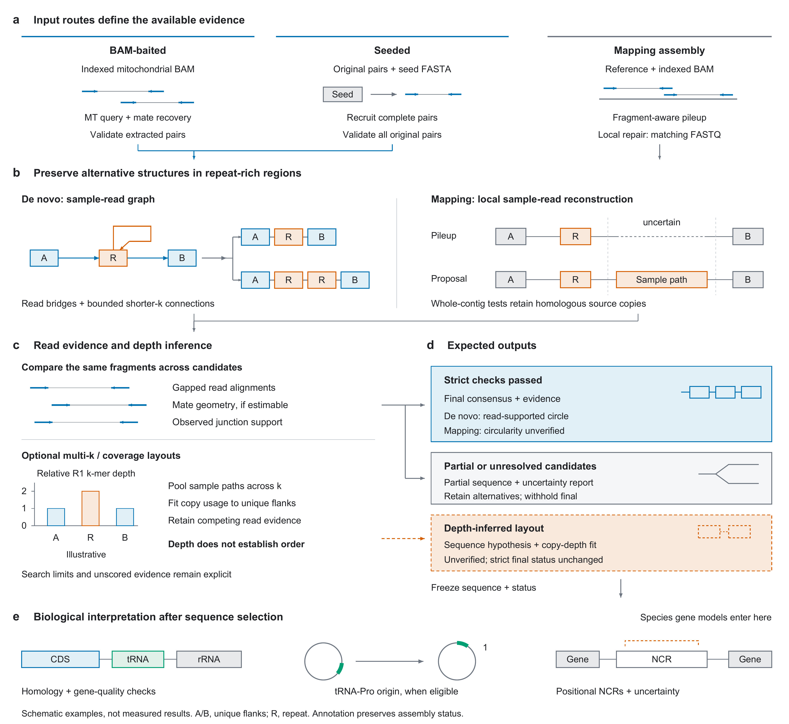

# Figure 1: reconstruction strategy and expected outputs

[](package_workflow.pdf)

[Vector PDF](package_workflow.pdf) · [Editable SVG](package_workflow.svg) · [600-dpi PNG](package_workflow.png) · [Drawing source](draw_package_workflow.py)

## Manuscript legend

**Fig. 1 | Evidence-aware reconstruction of repeat-rich mitochondrial genomes with mitovarr.**
**a,** Input routes retain distinct evidence scopes. BAM-baited assembly validates extracted pairs; seeded assembly validates original complete pairs. A seed recruits reads only, and recruitment must converge. Reference-guided processing uses coordinate-matched BAM alignments, with matching FASTQ for optional local reconstruction.
**b,** Sample graphs propose alternative repeat traversals. Read bridges and bounded shorter-k searches extend reconstruction. Local proposals are compared in whole-contig contexts retaining homologous source copies. A/B denote unique flanks and R a repeated segment; the interrupted pileup denotes uncertainty, not a measured deletion.
**c,** Bounded comparisons use the same named fragments, gapped alignments, estimable mate geometry and observed junctions. Thin connectors between mates are unsequenced intervals. Optional multi-k layouts fit R1 k-mer occurrence depth relative to unique flanks and expose competing read evidence. The normalized depth bars are illustrative, not measurements. Depth constrains copy usage, not repeat order; agreement across k values does not multiply support.
**d,** Strict final output requires supported bases and joins without unresolved structural alternatives or required incomplete searches. De novo completion requires a read-supported circle; mapping completion does not certify circularity. Partial or unresolved candidates remain available for region-specific evaluation, with alternatives and uncertainty but no final consensus. Depth-inferred layouts remain explicitly unverified.
**e,** Frozen sequences undergo independent homology annotation, gene-quality checks, eligible tRNA-Pro normalization and positional NCR interpretation. Rotation requires circular input interpretation and a unique complete anchor; annotation preserves assembly status. NCR1 completeness is not a gene-quality requirement. All panels are schematic and not to scale.

## Strategy and interpretation

The figure explains how read evidence constrains repeat-rich mitochondrial
reconstruction and which outputs can be expected under different evidence
conditions. The three states in panel d are **conditional outcomes**, not
measured success rates. A consensus passing the implemented checks, a
coverage-derived hypothesis and an unresolved representative carry different
claims. Gene completeness or an N-free sequence alone does not establish a
resolved repeat structure.

The optional layout branch is explicit because it does not change strict
primary/final selection. In de novo mode the reported coverage representative
is preserved and paired comparison is diagnostic. In mapping mode retained
sample layouts are compared using a common fragment cohort and a joint copy
budget across windows. Neither route turns copy-depth fit into structural
validation. Search limits, competing evidence and layout uncertainty remain
reported.

Optional whole-layout scoring compares at most eight sample paths plus the
baseline. The shortlist retains the best coverage fit, then represents repeat
counts and orders before further sequence variants. Common-fragment eligibility
is frozen against all generated paths; reports identify unscored families.

Partial availability is not a quality pass. Uncertainty reports can flag an
entire de novo primary component, not only a narrow NCR interval. The independent
`gene_quality.tsv` checks retain any overlap with supplied uncertainty;
they do not perform read validation. See [partial results](../partial_results.md).

## Panel-to-command correspondence

| Panel | Commands and interpretation |
| --- | --- |
| a | De novo assembly: `fetch-caendr` then `assemble-baited`, or `assemble-seeded`. Mapping assembly: `assemble-mapping`. BAM extraction is the baiting step. Only sample reads enter de novo assembly; the seed supplies no assembly sequence. |
| b | Native graph reconstruction, read-supported repeat paths and optional `--local-assembly` from matching paired FASTQ. Hypothetical one- and two-repeat spellings illustrate alternatives without selecting a biological copy count. |
| c | Common-fragment comparisons (mapping requires `--deep-validation`); optional `--coverage-layout`, with `--multi-k-layout` to extend the hypothesis pool. The R1 depth illustration normalizes unique flanks to 1 and shows a hypothetical twofold repeat depth; it is not an experimental result or a sufficient copy-number test. |
| d | Conditional `consensus.fasta`; de novo `primary.fasta` or mapping `candidate.fasta` with alternatives and ambiguity; optional `coverage_layout.fasta` and supporting reports with `final_verified=false`. Files depend on workflow and candidate availability. |
| e | `annotate` on a frozen FASTA, optionally with `--rotate-to-trna-pro` and coordinate-compatible `--assembly-ambiguity`. Species gene models enter annotation after assembly selection; `gene_quality.tsv` reports per-model checks. The NCR label is positional, and the dashed bracket denotes carried uncertainty. |

Mapping local mode now defaults to fast consensus with deferred structural
scoring; its best-effort primary uses `maximum_consensus.ambiguity.tsv`. The
structural comparison stages shown here describe opt-in `--deep-validation`.

The [method guides](../README.md) and
[detailed method schematic](../figure_1_workflow/README.md) describe the search
limits, coordinate contracts and validation rules. The main implementation
links are [de novo assembly](../../src/denovo.rs),
[de novo layouts](../../src/denovo/layout.rs),
[mapping reconstruction](../../src/mapping.rs),
[mapping layouts](../../src/mapping/coverage.rs) and
[annotation](../../src/annotation/mod.rs).

## Artwork and reproduction

The artwork is **183 x 168 mm** in RGB. Arial labels are **6-7 pt**,
with **8-pt bold lowercase panel letters** and a **5.8-pt schematic key**.
Lines are **0.35-1 pt**. Colours distinguish sequence elements and evidence
states; black text, explicit labels and solid/dashed boundaries preserve
interpretation without relying on colour alone. The PDF embeds TrueType fonts;
the plain SVG retains live text and named panel groups. The 600-dpi PNG is the
README preview. Use the PDF or SVG for vector artwork submission.

The layout follows Nature's official guidance on
[fonts, accessible colour and editable vector export](https://research-figure-guide.nature.com/figures/preparing-figures-our-specifications/)
and [dimensions and panel arrangement](https://research-figure-guide.nature.com/figures/building-and-exporting-figure-panels/),
checked on 2026-10-03. Final sizing remains subject to journal production.

Rebuild with Python and ReportLab; add Poppler (`pdftoppm`) for PNG export:

```bash
python docs/figures/draw_package_workflow.py --png --dpi 600
```

Omit `--png` to regenerate only PDF and SVG. On systems without the macOS
Arial fonts, set `MITOVARR_FIGURE_FONT_DIR` to a directory containing
`Arial.ttf` and `Arial Bold.ttf`. These are documentation tools, independent
of the Rust build and runtime.
